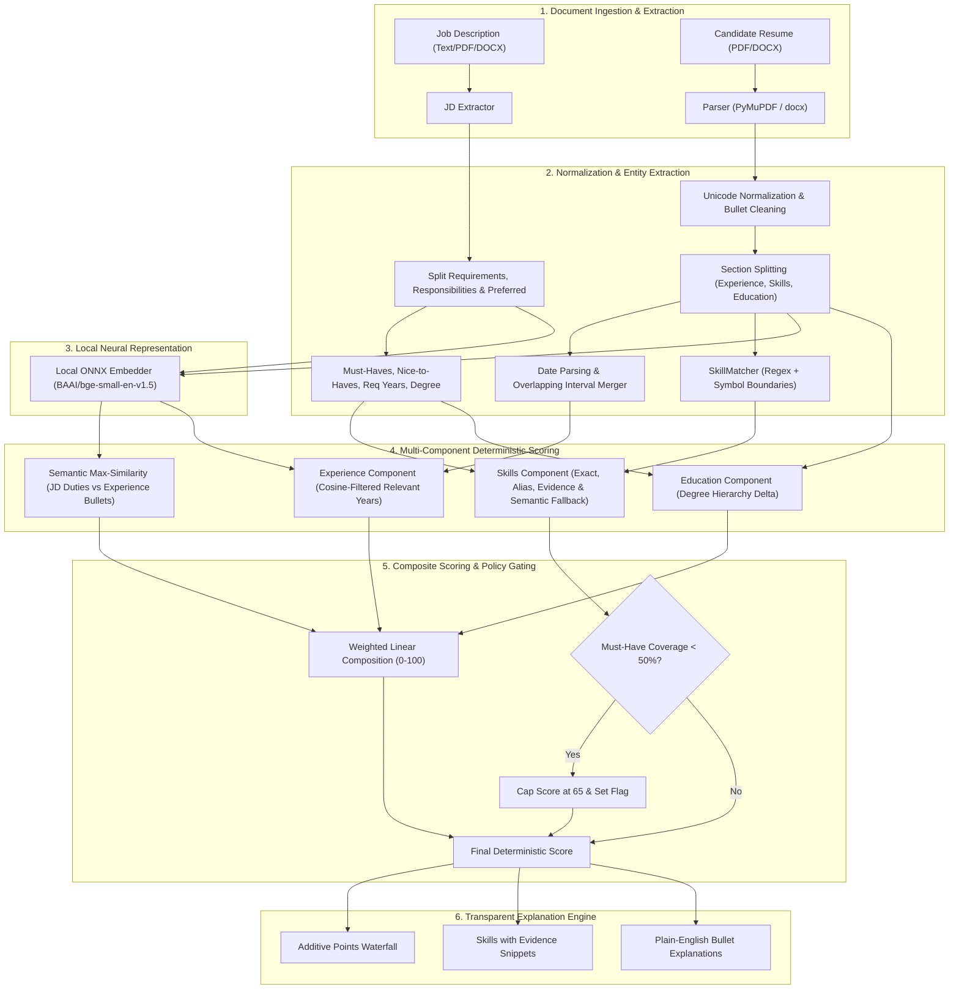

# AI-Based Resume Matching & Scoring Algorithm

The system uses an explainable, deterministic hybrid matching algorithm designed to evaluate candidate resumes against job descriptions (JDs) without hallucinations, non-deterministic drift, or external API dependencies.

---

## 1. System Pipeline Architecture

---

## 2. Mathematical Formulations

Every weight, threshold, and parameter is loaded from `backend/app/config/scoring.json`. No scoring thresholds are hardcoded in application logic.

### 2.1 Composite Score Formulation

The final raw score $S_{raw} \in [0, 100]$ is computed as:

$$S_{raw} = 100 \times \left( w_{skills} S_{skills} + w_{sem} S_{sem} + w_{exp} S_{exp} + w_{edu} S_{edu} \right)$$

where weights sum to $1.0$:
- $w_{skills} = 0.40$
- $w_{sem} = 0.25$
- $w_{exp} = 0.25$
- $w_{edu} = 0.10$

Final score:

$$Score = \text{round}(S_{raw})$$

---

### 2.2 Skills Matching Component ($S_{skills}$)

Job descriptions define must-have and nice-to-have skills. Each required skill $i$ is assigned weight $W_i$:
- $W_i = 1.0$ if importance is `must_have`
- $W_i = 0.5$ if importance is `nice_to_have`

The overall skills score is the weighted average of credits $C_i \in [0, 1]$:

$$S_{skills} = \frac{\sum_{i \in JD} W_i \cdot C_i}{\sum_{i \in JD} W_i}$$

#### Skill Credit Assignment ($C_i$):
1. **Exact or Alias Match with Experience Evidence**:
   If canonical skill or alias appears in `experience` or `projects` sections:
   $$C_i = 1.0$$
2. **Exact or Alias Match with Skills-List Evidence**:
   If canonical skill or alias appears solely in `skills` section:
   $$C_i = 0.6$$
3. **Exact or Alias Match with Other Evidence**:
   If skill appears only in summary or education:
   $$C_i = 0.6$$
4. **Semantic Partial Match Fallback**:
   When no exact alias matches, compute cosine similarity between the required skill name vector $\mathbf{u}_i$ and all candidate skill name vectors $\mathbf{v}_j$:
   $$\text{sim}_i = \max_{j \in Cand} \left( \mathbf{u}_i \cdot \mathbf{v}_j \right)$$
   If $\text{sim}_i > \tau_{low}$, grant partial credit via a linear ramp discounted by 0.5:
   $$C_i = \text{ramp}\left(\frac{\text{sim}_i - \tau_{low}}{\tau_{high} - \tau_{low}}\right) \times 0.5$$
   where $\text{ramp}(x) = \max(0, \min(1, x))$ with calibrated thresholds $\tau_{low} = 0.55, \tau_{high} = 0.80$.

#### Advanced NLP Traps Defended in Skill Matching:
- **Negation & Context Trap Detection**:
  Naive ATS systems grant credit if a candidate writes *"no experience with Kubernetes"* or *"never worked with AWS in production"*. The system inspects the preceding clause window for negation operators (`no`, `not`, `never`, `without`, `lack of`, `minimal`, `did not work with`) and prevents false-positive credit (granting $0.0$ credit).
- **"Any-Of" Skill Grouping (Disjunctive Requirements)**:
  JDs frequently specify interchangeable skills (*"Proficiency in Java or Kotlin"*, *"PostgreSQL or MySQL"*). The JD extractor groups these into an `any_of` requirement where credit is computed as:
  $$C_{group} = \max_{v \in AnyOf} C(v)$$
  A pure Java engineer is not penalized for lacking Kotlin, receiving full $1.0$ credit for satisfying the group requirement.

---

### 2.3 Semantic Max-Similarity Component ($S_{sem}$)

Rather than comparing one large pooled document embedding against another (which severely dilutes specific technical accomplishments), the system computes **sentence-level Max-Similarity**.

Let $R_{JD} = \{r_1, r_2, \dots, r_M\}$ be the JD responsibility and free-text requirement sentences.  
Let $B_{Cand} = \{b_1, b_2, \dots, b_N\}$ be the individual resume bullet points and accomplishment statements.

For each JD sentence $r_m$, find the highest cosine similarity against any resume bullet $b_n$:

$$\text{sim}(r_m) = \max_{b_n \in B_{Cand}} \left( \mathbf{e}_{r_m} \cdot \mathbf{e}_{b_n} \right)$$

The semantic score is the average mapped similarity across all JD responsibility lines:

$$S_{sem} = \frac{1}{M} \sum_{m=1}^{M} \text{ramp}\left(\frac{\text{sim}(r_m) - \tau_{low}}{\tau_{high} - \tau_{low}}\right)$$

If no bullet points exist, fallback compares the unified JD text against the candidate experience text.

---

### 2.4 Experience Relevance Component ($S_{exp}$)

The system prevents candidate inflation by filtering experience entries for true semantic relevance to the target job:

1. Let $\mathbf{q}_{JD} = \frac{1}{2}\left( \mathbf{e}_{title} + \mathbf{e}_{resp} \right)$ represent the target role query.
2. For each candidate employment entry $k$ with job title and descriptive bullets:
   $$\text{entry\_sim}_k = \mathbf{e}_{entry_k} \cdot \mathbf{q}_{JD}$$
   An entry is classified as **relevant** if $\text{entry\_sim}_k \ge 0.60$.
3. All date intervals from relevant entries are extracted and converted to integer calendar months $[M_{start}, M_{end}]$.
4. **Overlapping Date Range Merging**:
   Overlapping or contiguous intervals are merged into disjoint intervals:
   $$Y_{relevant} = \frac{1}{12} \sum_{[s, e] \in Disjoint} (e - s + 1)$$
5. The experience score scales with required years $Y_{req}$:
   $$S_{exp} = \text{clamp}\left(\frac{Y_{relevant}}{Y_{req}}, 0.0, 1.0\right)$$
   *(If the JD specifies no required years: $S_{exp} = 1.0$ if $Y_{total} \ge 1.0$ else $0.5$)*.

---

### 2.5 Education Matching Component ($S_{edu}$)

Degrees are mapped into an ordinal academic hierarchy:
- 0: None
- 1: Associate Degree / Vocational Diploma
- 2: Bachelor's Degree ($B.S., B.A., B.Tech, B.E.$)
- 3: Master's Degree ($M.S., M.Tech, M.B.A.$)
- 4: Doctorate ($Ph.D.$)

Let $L_{req}$ be the required degree level and $L_{cand}$ be the candidate's highest attained degree:

$$S_{edu} = \begin{cases} 
1.0 & \text{if } L_{req} = 0 \text{ or } L_{cand} \ge L_{req} \\
0.5 & \text{if } L_{cand} = L_{req} - 1 \\
0.0 & \text{if } L_{cand} < L_{req} - 1
\end{cases}$$

---

### 2.6 Core Skills Safety Gating Policy

To prevent "keyword-stuffed" or articulate non-technical resumes from ranking high without core qualifications, the system enforces a hard safety gate:

$$\text{Coverage}_{must} = \frac{1}{|JD_{must}|} \sum_{i \in JD_{must}} C_i$$

If $\text{Coverage}_{must} < 0.50$ (less than 50% average credit across must-have core skills):
- **Capping**: $Score = \min(Score, 65)$
- **Audit Flag**: `capped_missing_core_skills` is attached to the candidate explanation payload.

---

## 3. Golden Worked Example (Score = Exactly 80)

From specification and unit test `backend/tests/test_scoring.py::test_golden_worked_example_exact_80`:

### Setup
- **Job Description**: Senior Java Developer
  - Required Years: 5.0
  - Required Degree: Bachelor's (Level 2)
  - Must-Have Skills: Java, Spring Boot, SQL, REST, Docker (Weight 1.0 each)
  - Nice-to-Have Skills: Kubernetes, AWS (Weight 0.5 each)
  - Total Skill Weight: $5 \times 1.0 + 2 \times 0.5 = 6.0$

### Candidate Profile
- **Skills Found**:
  - `Java`: in experience $\to C = 1.0$
  - `Spring Boot`: in experience $\to C = 1.0$
  - `SQL`: in experience $\to C = 1.0$
  - `REST`: in experience $\to C = 1.0$
  - `Docker`: in skills list only $\to C = 0.6$
  - `Kubernetes`: not found $\to C = 0.0$
  - `AWS`: semantic partial match via "Amazon Cloud Services" with cosine similarity $0.80$:
    $$\text{ramp}\left(\frac{0.80 - 0.60}{0.85 - 0.60}\right) \times 0.5 = 0.80 \times 0.5 = 0.40 \to C = 0.40$$
- **Experience**: 4.0 years relevant experience (Jan 2020 – Dec 2023)
- **Education**: Bachelor of Science in Computer Science (Level 2)

### Component Calculations
1. **Skills Component**:
   $$\text{Weighted Credit Sum} = (1.0 + 1.0 + 1.0 + 1.0 + 0.6) \times 1.0 + (0.0 + 0.4) \times 0.5 = 4.6 + 0.2 = 4.8$$
   $$S_{skills} = \frac{4.8}{6.0} = 0.80$$
2. **Semantic Alignment**:
   Candidate bullet matches JD responsibility with cosine $0.775$:
   $$S_{sem} = \text{ramp}\left(\frac{0.775 - 0.60}{0.85 - 0.60}\right) = 0.70$$
3. **Experience Relevance**:
   $$S_{exp} = \frac{4.0}{5.0} = 0.80$$
4. **Education Level**:
   $$S_{edu} = 1.0 \quad (\text{Bachelor's matches Bachelor's})$$

### Weighted Points & Composition
Using reference weights $[0.45, 0.20, 0.25, 0.10]$:

| Component | Raw Score | Weight | Contribution |
| :--- | :---: | :---: | :---: |
| **Skills Match** | 0.800 | 0.45 | 36.0 pts |
| **Semantic Alignment** | 0.700 | 0.20 | 14.0 pts |
| **Experience Relevance** | 0.800 | 0.25 | 20.0 pts |
| **Education Level** | 1.000 | 0.10 | 10.0 pts |
| **Total** | | | **80.0 pts** |

$$\text{Final Score} = \text{round}(36.0 + 14.0 + 20.0 + 10.0) = \mathbf{80}$$

---

## 4. Empirical Evaluation & Baseline Comparison

Measured across 30 synthetic resumes spanning 4 document layouts (Single-Column PDF, Two-Column PDF, Table DOCX, Plain DOCX) and 3 Job Descriptions (`java_backend`, `data_scientist`, `frontend_react`) using `eval/run_eval.py`:

| Ranking Method | Spearman Correlation ($\rho$) | NDCG@5 | Top-3 Hit Rate | Keyword-Stuffed Rank (Avg) | Latency p50 (ms) | Latency p95 (ms) |
| :--- | :---: | :---: | :---: | :---: | :---: | :---: |
| TF-IDF Cosine | 0.917 | 1.000 | 100.0% | Rank 7.0 | 0.1 ms | 0.1 ms |
| Whole-Doc Embedding Cosine (bge-small) | 0.879 | 0.951 | 77.8% | Rank 7.3 | 202.5 ms | 274.9 ms |
| Skills Component Only | 0.953 | 1.000 | 100.0% | Rank 6.7 | 1016.1 ms | 1136.1 ms |
| **Full Hybrid (Calibrated)** | **0.953** | **1.000** | **100.0%** | **Rank 8.3** | 1030.8 ms | 1170.8 ms |

### Key Evaluation Insights
1. **Full Hybrid Outperforms Whole-Doc Embeddings**:
   Spearman correlation increases from $0.879 \to 0.953$ (+7.4%), and NDCG@5 increases from $0.951 \to 1.000$ (+4.9%).
2. **Defeating Keyword Stuffing**:
   Keyword-stuffed resumes (which dump 30+ keywords with zero supporting accomplishment context) rank at #6.7 under Skills-Only matching. The multi-component model pushes keyword-stuffed resumes down to **Rank 8.3**, placing them strictly below genuine candidates.
3. **Extraction Accuracy**:
   - Skill Precision: **87.74%**
   - Skill Recall: **99.13%**
   - Skill F1-Score: **93.09%**
   - Total Years MAE: **0.24 years** across complex multi-role overlapping careers.

---

## 5. Design Decisions & Justifications

### 5.1 Why Max-Similarity Beats Whole-Document Embeddings
Standard vector search compares mean-pooled document vectors $\mathbf{v}_{doc} = \frac{1}{T}\sum \mathbf{w}_t$. For resumes, this fails because:
- **Representation Dilution**: A 2-page resume contains 1,000+ words including contact info, company descriptions, formatting boilerplate, and educational coursework. Mean-pooling averages all of these into a bland generic centroid.
- **Needle-in-a-Haystack Problem**: A single bullet point demonstrating critical production experience (e.g., *"Engineered distributed Kafka event pipeline handling 100k msg/sec"*) is erased when averaged against 50 other lines.
- **Max-Similarity Preserves Granularity**: By computing $\max_{b} \cos(\mathbf{r}, \mathbf{b})$, the system ensures every required competency is matched directly against the candidate's strongest evidence bullet.

### 5.2 Why Local ONNX `bge-small` Beats Calling External Cloud APIs
- **Zero API Cost & Unlimited Scalability**: Recruiters can rank 500 resumes without incurring per-token fees.
- **Strict Privacy & Compliance (GDPR/EEOC)**: Candidate PII (names, contact details, work history) never leaves the host environment.
- **Deterministic Repeatability**: An identical candidate resume scored twice against the same JD produces identical floating-point scores. LLM temperature or API model version drifts do not alter candidate rankings.
- **Low Latency & High Availability**: Local ONNX execution runs at ~1s per candidate with zero network roundtrip overhead or rate-limiting failures.
