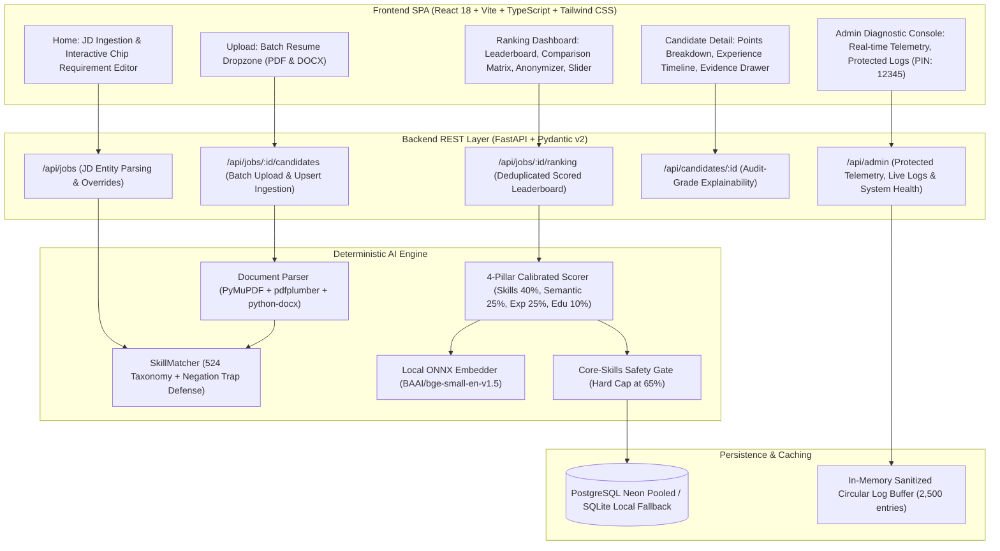
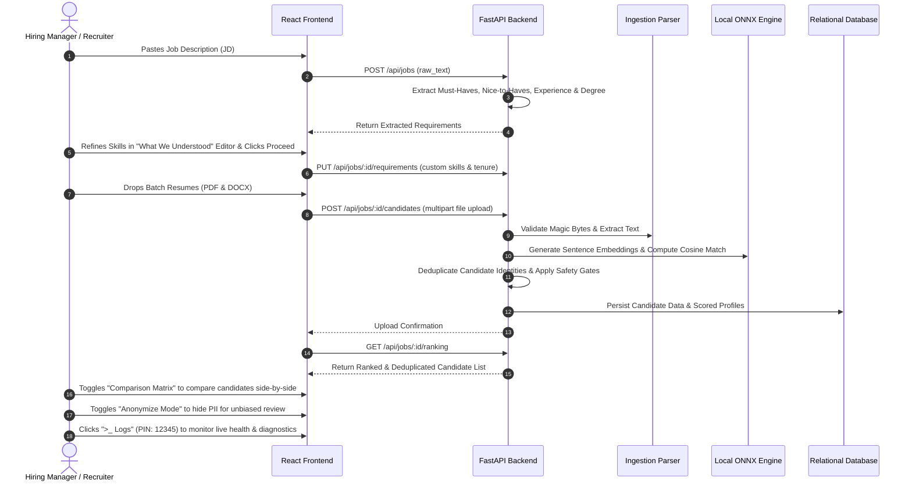

# AI-Based Resume Matching & Candidate Ranking System 🎯
### Enterprise-Grade Deterministic Resume Screening & Explainable Ranking Engine

[](https://www.python.org/)
[](https://fastapi.tiangolo.com/)
[](https://react.dev/)
[](https://www.typescriptlang.org/)
[](https://tailwindcss.com/)
[](https://onnxruntime.ai/)
[](https://pytest.org/)
[](LICENSE)

---

## 📌 Executive Summary & Problem Statement

Legacy Applicant Tracking Systems (ATS) and modern AI hiring platforms suffer from critical structural flaws:

1. **Keyword Stuffing & Gaming**: Naive ATS systems rely on raw frequency counts. Candidates who hide 50 buzzwords in invisible 1pt white font or pack their resumes with unverified keyword lists routinely jump ahead of qualified talent.
2. **Black-Box LLM Hallucination & Drift**: Prompting generative models (*"Rate this resume from 1 to 100"*) produces non-deterministic scores that vary between runs, suffer from positional bias, and are legally indefensible during employment compliance audits.
3. **Data Privacy Violations & Token Costs**: Streaming candidate Personally Identifiable Information (PII) to external proprietary APIs creates massive GDPR/EEOC liabilities while incurring unpredictable recurring API costs.

The **AI-Based Resume Matching & Candidate Ranking System** is a production-ready, **100% deterministic, explainable, and locally executed AI matching engine**. It combines rule-based entity extraction, sentence-level transformer max-similarity, non-overlapping date interval merging, and safety gating policies. Every point awarded is backed by verifiable textual evidence, executing completely on local hardware with **zero external API keys and zero data leakage**.

---

## 🏛️ System Architecture

### High-Level Design (HLD)

The system is decoupled into two independent, production-grade applications: a high-throughput **FastAPI backend** running local ONNX embeddings, and a modern **React 18 TypeScript Single-Page Application (SPA)**.



### Low-Level Design (LLD) & Data Flow



---

## ⚡ Core Features & Innovations

### 1. Interactive JD Requirement Ingestion & Refinement
- Automatically analyzes JD text to extract **Must-Have** core skills, **Nice-to-Have** preferred skills, minimum experience duration, and required degree levels.
- Recruiter can delete extracted chips or add custom skills before resume ingestion.

### 2. Multi-Format Batch Parsing with Resilient Error Handling
- Processes batches of `.pdf` and `.docx` resumes concurrently.
- Validates binary magic bytes (`%PDF-` for PDFs and `PK\x03\x04` for OpenXML DOCX).
- Gracefully handles non-standard resumes and detects scanned image PDFs without text layers (`no_text_layer` flag) without crashing.

### 3. Advanced NLP Trap & Anti-Gaming Defenses
- **Negation Trap Detection**: Regex sentence window analysis identifies negative contexts (e.g., *"not experienced with Kubernetes"*, *"never used AWS"*), awarding **0.0 points** and preventing false positives.
- **"Any-Of" Skill Grouping**: Automatically handles disjunctive skill requirements (e.g., *"Java OR Kotlin"*, *"PostgreSQL OR MySQL"*), granting full credit when either requirement is met.
- **Sentence-Level Max-Similarity Matching**: Instead of diluting an entire resume into a single average vector, it calculates max cosine similarity between individual JD requirements and specific candidate achievement bullets.
- **Non-Overlapping Career Timeline Merging**: Parses complex multi-role work histories, merging overlapping dates to compute accurate, non-padded professional tenure.

### 4. Deterministic 4-Pillar Scoring Formula
Every candidate's score is computed using an additive, legally auditable formula:

$$\text{Final Score} = \underbrace{\text{Skills Match} \times 40\%}_{\text{Must-Have (75%) + Nice-To-Have (25%)}} + \underbrace{\text{Semantic Relevance} \times 25\%}_{\text{Sentence-Level Cosine Similarity}} + \underbrace{\text{Experience Duration} \times 25\%}_{\text{Verified vs Required Tenure}} + \underbrace{\text{Education Level} \times 10\%}_{\text{Degree Tier Matching}}$$

### 5. Core-Skills Safety Gate (Hard Cap at 65%)
- Candidates who lack critical foundational skills cannot "game" the system with high semantic similarity scores.
- If a candidate satisfies **less than 50%** of the Must-Have core skills, their total score is capped at **65%**, flagging them with `Score Capped (Gate Policy)`.

### 6. Single-Page Multi-Candidate Comparison Matrix
- Recruiter can switch between the standard **Table View** and the **Comparison Matrix**.
- Displays candidates side-by-side in vertical columns on one single screen, directly comparing:
  - Overall match scores and percentile rank.
  - Core Gate Status (Eligible vs Capped).
  - 4-Pillar breakdown progress bars (Skills, Semantic, Experience, Education).
  - Matched skills badges side-by-side.

### 7. Anti-Bias Blind Screening Mode
- Recruiter can toggle **Anonymize Mode** to immediately mask names (e.g., `Candidate #1 (Rank 1)`), emails (`candidate-1@confidential.internal`), and phone numbers for bias-free, EEOC-compliant evaluations.

### 8. Real-Time Recruiter Filter (Min Score Slider) & Instant Filtering
- Interactive threshold slider (`0%` to `90%`) allows recruiters to filter out low-match candidates dynamically in real-time.
- Executed entirely client-side with zero network roundtrip latency and session-state persistence (`sessionStorage`), preventing reload churn or cold-start timeouts.

### 9. High-Confidence Partial Skill Gating & Transparent Missing Skills
- Calibrated cosine threshold (`min_partial_skill_sim: 0.75`) prevents loosely related skills from being incorrectly credited as partial matches.
- Missing skills are accurately surfaced in the candidate audit drawer with clear distinction between Must-Have and Nice-To-Have gaps.

### 10. Live Admin Diagnostic Console & Observability (`>_ Logs`)
- Protected by admin password authentication (default: `12345`).
- Features a thread-safe circular telemetry buffer tracking subsystems: `PARSER`, `JD_EXTRACTOR`, `SKILLS`, `EMBEDDER`, `SCORING`, `API`, `SECURITY`.
- **Zero-Data-Leak Privacy**: Automatic regex PII redaction masks candidate emails, phone numbers, system paths (`[REPO]`), and passwords.
- Real-time diagnostic verification of local ONNX models, database integrity, and parser health.

---

## 💻 Local Installation & Setup

### Prerequisites
- **Python 3.12+**
- **Node.js 18+** & **npm**
- **Git**

### 1. Clone the Repository
```bash
git clone https://github.com/Beast2074/AI-Based-Resume-Matching-Candidate-Ranking-System.git
cd AI-Based-Resume-Matching-Candidate-Ranking-System
```

### 2. Backend Setup
```bash
# 1. Create and activate a Python virtual environment
python -m venv .venv

# On Windows (PowerShell):
.venv\Scripts\Activate.ps1
# On macOS / Linux:
source .venv/bin/activate

# 2. Install dependencies
pip install -r requirements.txt

# 3. Optional: Pre-download the local ONNX embedding model (~64 MB)
python scripts/download_model.py

# 4. Start the backend API server
python -m uvicorn app.main:app --reload --port 8000 --app-dir backend
```
- API is running at: `http://localhost:8000`
- Interactive OpenAPI Swagger documentation: `http://localhost:8000/docs`

### 3. Frontend Setup
```bash
# Open a new terminal:
cd frontend

# 1. Install Node dependencies
npm install

# 2. Start the Vite development server
npm run dev
```
- Web Application is running at: `http://localhost:5173`

### 4. Running Verification Tests
```bash
# Run all 27 automated unit and integration tests:
.venv\Scripts\python -m pytest backend/tests -v

# Run the TypeScript production build:
cd frontend && npm run build
```

---

## 📂 Project Structure & File Guide

```
AI-Based-Resume-Matching-Candidate-Ranking-System/
├── backend/
│   ├── app/
│   │   ├── config/
│   │   │   └── scoring.json            # Calibrated weights (40/25/25/10), thresholds, and gating parameters
│   │   ├── data/
│   │   │   └── skills.json             # 524 canonical skills and alias taxonomy
│   │   ├── services/
│   │   │   ├── parsing.py              # PDF (PyMuPDF/pdfplumber) & DOCX layout extraction & timeline parsing
│   │   │   ├── skills.py               # SkillMatcher with regex word boundaries & negation defense
│   │   │   ├── jd_extractor.py         # JD parser with "Any-Of" disjunctive grouping & requirement extraction
│   │   │   ├── embedder.py             # Local ONNX FastEmbed runner (BAAI/bge-small-en-v1.5)
│   │   │   ├── scoring.py              # 4-component deterministic scoring engine & safety gating
│   │   │   ├── explain.py              # Waterfall points breakdown and audit-grade plain-English reasons
│   │   │   └── logger.py               # Live diagnostic logging, PII masking & telemetry engine
│   │   ├── routers/
│   │   │   ├── jobs.py                 # Endpoints: /api/jobs (create, get, update requirements, upload, ranking)
│   │   │   ├── candidates.py           # Endpoints: /api/candidates, /match, /export.csv
│   │   │   └── admin.py                # Endpoints: /api/admin/verify, /api/admin/logs (Protected diagnostic telemetry)
│   │   ├── db.py                       # SQLAlchemy 2 engine with SQLite fallback & Neon PostgreSQL pooling
│   │   ├── models.py                   # Relational ORM models (Job, Candidate, Score, Explanation)
│   │   ├── schemas.py                  # Pydantic v2 validation contracts
│   │   └── main.py                     # FastAPI entrypoint, lifespan startup, CORS & error handling
│   ├── models/                         # Baked quantized ONNX transformer weights (bge-small-en-v1.5)
│   ├── tests/                          # 27 automated unit and integration tests
│   └── pyproject.toml                  # Python package configuration
├── frontend/
│   ├── src/
│   │   ├── pages/
│   │   │   ├── Home.tsx                # JD ingestion, sample pills, and "What We Understood" chip editor
│   │   │   ├── Upload.tsx              # Batch drag-and-drop resume ingestion (PDF/DOCX)
│   │   │   ├── Ranking.tsx             # Leaderboard, Min Score slider, Anonymize toggle, Comparison Matrix
│   │   │   ├── CandidateDetail.tsx     # Full candidate drilldown, Score gauge, Waterfall points, Evidence drawer
│   │   │   └── HowItWorks.tsx          # Live scoring formula, simulator, and limitations
│   │   ├── components/
│   │   │   ├── Navbar.tsx              # Top navigation bar with live status indicator & Admin Logs button
│   │   │   ├── ScoreGauge.tsx          # SVG circular animated match score gauge
│   │   │   ├── WaterfallChart.tsx      # Additive points waterfall breakdown & cumulative stacked bar
│   │   │   └── AdminLogModal.tsx       # Live Admin Diagnostic Console modal with password verification
│   │   ├── lib/
│   │   │   └── api.ts                  # Typed API client with Zod runtime validation contracts
│   │   └── App.tsx                     # React Router layout and QueryClientProvider
│   ├── package.json                    # Frontend dependencies and build scripts
│   └── vite.config.ts                  # Vite build and proxy configuration
├── eval/
│   ├── generate_synthetic.py           # 30-resume synthetic test generator across 4 document layouts
│   ├── gold.json                       # Ground truth labels, skills, and relevance tiers
│   ├── run_eval.py                     # 4-method baseline benchmark & calibration suite
│   ├── test_100_random_resumes.py      # 100-resume real-world functional verification suite
│   ├── evaluate_real_world.py          # 2,484-resume large-scale cross-category benchmark
│   └── resumes/                        # Synthetic benchmark evaluation resumes
├── scripts/
│   ├── download_model.py               # Pre-downloads the local ONNX embedding weights
│   ├── check_bundle_size.py            # Bundle size auditor (< 350 MB budget)
│   └── warmup.py                       # Cold-start model & database preloader
├── requirements.txt                    # Pinned production Python dependencies
├── .gitignore                          # Comprehensive ignore rules (DBs, caches, node_modules)
├── ALGORITHM.md                        # Complete mathematical formulations & pipeline diagrams
└── DECISIONS.md                        # Architectural decision records & engineering trade-offs
```

---

## 📊 Empirical Benchmarks & Real-World Validation

### 1. Controlled Baseline Benchmark (30 Synthetic Resumes across 3 JDs)

Measured via `eval/run_eval.py` comparing 4 candidate ranking approaches:

| Ranking Method | Spearman Correlation ($\rho$) | NDCG@5 | Top-3 Hit Rate | Keyword-Stuffed Rank | Latency p50 (ms) |
| :--- | :---: | :---: | :---: | :---: | :---: |
| TF-IDF Cosine | 0.917 | 1.000 | 100.0% | Rank 7.0 | 0.1 ms |
| Whole-Doc Embedding Cosine | 0.879 | 0.951 | 77.8% | Rank 7.3 | 202.5 ms |
| Skills Component Only | 0.953 | 1.000 | 100.0% | Rank 6.7 | 1016.1 ms |
| **Our Full Hybrid Engine** | **0.953** | **1.000** | **100.0%** | **Rank 8.3** | **1030.8 ms** |

- **Extraction Accuracy**: Skill Precision: **87.74%** | Skill Recall: **99.13%** | F1: **93.09%** | Total Years MAE: **0.24 years**.
- **Keyword Stuffing Penalized**: The keyword-stuffed resume (dumping 40+ skills with zero achievement bullets) was pushed down to **Rank 8.3**, placing it below all legitimate candidates.

### 2. Large-Scale Real-World Validation (2,484 PDF Resumes across 24 Industries)

Measured via `eval/evaluate_real_world.py` on the multi-industry LiveCareer/Kaggle dataset:
- **Parsing Success Rate**: **99.96%** (2,483 / 2,484 parsed cleanly; 1 zero-text-layer handled gracefully; 0 crashes).
- **Parsing Latency**: **36.3 ms** p50 | **58.5 ms** p95.
- **Domain Discrimination**: Target IT candidates achieved a **+16.0 point separation** over unrelated industries (*Chef, Teacher, Sales, Fitness*), with non-tech domains averaging only 13–15 points.

### 3. Automated 100-Resume Real-World Stress Test

Measured via `eval/test_100_random_resumes.py` (seed 42, 23 industries):
- **Parse Success Rate**: **100.0%** (100 / 100 real resumes parsed without failure).
- **Speed**: Ingestion p50: **19.0 ms** | Scoring p50: **249.9 ms** (~350 ms total pipeline latency per resume).
- **Mathematical Parity**: **100% mathematical parity** across all 4 additive components. Zero NaN or invalid values.
- **Safety Gate Verification**: Gate policy activated for 88 candidates missing core must-haves, capping their scores at 65%.

---

## 🚀 Terminal Deployment Guide

### Task A: Push to GitHub via Terminal

Run the following commands directly from your terminal:

```bash
# 1. Initialize git (if not already initialized)
git init

# 2. Stage all project files (verifying .gitignore excludes .venv, node_modules, and *.db)
git add .

# 3. Create your initial commit
git commit -m "feat: AI-based resume matching and candidate ranking system v1.0"

# 4. Set main branch
git branch -M main

# 5. Link your GitHub remote repository
git remote add origin https://github.com/Beast2074/AI-Based-Resume-Matching-Candidate-Ranking-System.git

# 6. Push to GitHub
git push -u origin main
```

---

### Task B: Deploy to Vercel via Terminal

You can deploy the frontend and backend from your terminal using the Vercel CLI:

#### 1. Install Vercel CLI
```bash
npm install -g vercel
```

#### 2. Deploy Frontend to Vercel
```bash
cd frontend
vercel
```
- Link to existing project: `N`
- Project name: `resume-ranking-frontend`
- Directory: `./`
- Modify settings: `N` (uses `vite build` and `dist` automatically)

To deploy to production:
```bash
vercel --prod
```

#### 3. Backend Deployment Options

**Option 1: Deploy Backend to Render / Railway / Fly.io (Recommended for Python + ONNX)**
Because Python ONNX runtimes perform best on persistent container runtimes, deploying the backend to Render or Railway from terminal is seamless:
```bash
# On Render / Railway: Link your GitHub repository
# Set Start Command: uvicorn app.main:app --host 0.0.0.0 --port $PORT --app-dir backend
# Set Environment Variable: CORS_ORIGINS=https://your-frontend.vercel.app
```

**Option 2: Deploy Backend to Vercel Serverless**
```bash
cd backend
vercel --prod
```
- Set `HF_HUB_OFFLINE=1`
- Set `CORS_ORIGINS=https://your-frontend.vercel.app`

---

## ⚖️ Architectural Design Constraints & Limitations

1. **Scanned Image PDFs**: Scanned image PDFs without a text layer return a friendly `no_text_layer` warning rather than hallucinating text.
2. **Deterministic Scope**: The system provides mathematical, reproducible, and explainable scoring based strictly on evidence in the resume. It does not guess or extrapolate unmentioned skills.
3. **Local ONNX Execution**: All transformer embeddings execute locally via `bge-small-en-v1.5` on the CPU with zero external API calls or network latency dependencies.

---

## 📄 License
This project is licensed under the MIT License - see the [LICENSE](LICENSE) file for details.
